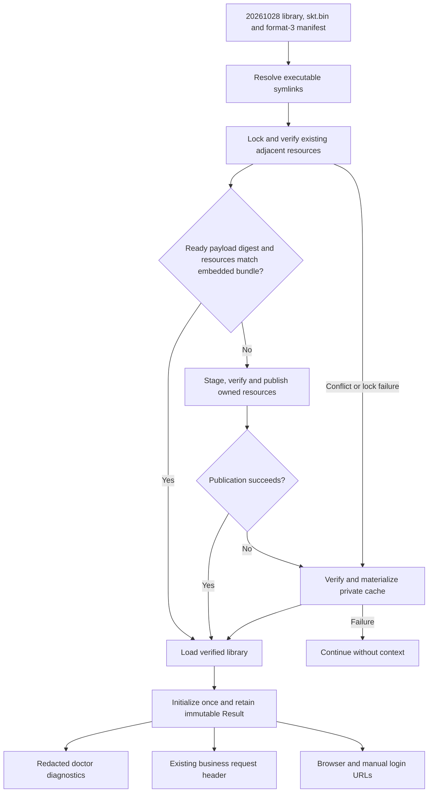

# Runtime context

DWS embeds runtime payload `20261028` in its single executable.
Five libraries and three platform-specific `skt.bin` configurations cover macOS,
Linux and Windows on amd64/arm64; macOS shares a universal library. Each target
bundle contains its library, configuration and a format-3 manifest pinning both
SHA-256 digests. Payload slots reserve 2 MiB on macOS/Linux and 8 MiB on Windows,
including headroom for signed libraries. Neither `ps/` nor Win32 is distributed.
Resource provenance and redistribution terms are recorded in the
[payload notice](../third_party/runtimepayload/20261028/NOTICE.md).

A payload digest change upgrades owned resources and selects a new cache root.
Source generation, installation, release injection and macOS signing all carry
the configuration checksum forward. Signing updates only the library checksum;
the configuration remains the platform-specific provider resource.

## Materialization and recovery

The loader resolves the executable's symbolic links before choosing its parent
directory. Homebrew therefore uses the real binary in `libexec`, not the link in
`bin`. It never selects the process working directory.

```text
<resolved-executable-directory>/
  dws (or dws.exe)
  <platform-library>
  skt.bin
  .dws-runtime-manifest.json
  .dws-runtime.lock
```

A nonblocking cross-process lock serializes adjacent publication. For an existing
ready bundle with the same payload digest, DWS reads the trusted manifest directly
from the verified embedded archive, compares it with the ownership record, and
checks every published resource once. Reuse does not create a staging directory
or extract another copy of the payload.

Installation and repair extract the embedded container into a hidden temporary
directory beside the executable. The dedicated ownership manifest reserves the fixed resource
names before publication (`pending`) and commits the verified result afterward
(`ready`). Existing valid resources are reused. Owned, interrupted or damaged
resources can be repaired; unknown files and symbolic links are never replaced.
Valid format-1 ownership records from `20260825` and `20260908` authorize a
library upgrade. Format-2 records from `20260909` also authorize a library
upgrade, but neither old format owns the new `skt.bin` name. If that name already
exists without format-3 ownership, DWS uses cache and preserves the file. Their old `ps/` directories are left untouched: this version
does not publish, traverse, hash, repair, or require those files.
Interrupted staging directories are not load sources.

If the directory cannot be resolved or written, another publisher holds its
lock, or publication fails (including a loaded Windows DLL), DWS uses a verified
content-addressed cache:

```text
<user-cache>/dws/runtime-context/20261028/<payload-sha256>/
```

Both paths compare the manifest with the embedded bundle and verify both library and configuration
checksums before returning a library. A cache cannot authorize replacement bytes
by changing its own manifest. Dedicated build/cache roots contain exactly those three files; adjacent
publication preserves unrelated files beside the executable. Previous-version caches are left
alone and are not used. Failure of both locations leaves the context unavailable
without blocking login or business requests.



## Login authorization URLs

`Result.AttachToURL(rawURL string) (string, bool)` attaches `callerUmt` and
`caller=dws` together only when the context is ready and its value is valid.
It uses URL encoding, preserves other query parameters and fragments, and
replaces duplicate parameters with one value each. Invalid HTTP(S) URLs or an
unavailable context return the original URL and `false`.

OAuth's initial browser URL, terminal manual link, and `/api/status`
reauthorization URL use one snapshot. The page consumes the complete
`authorizeUrl` directly. CLI locale selection does not add a `lang` query
parameter to login URLs, including displayed manual links and `--no-browser`.
Device Flow resolves one snapshot before its retry
loop and reuses it for up to three attempts. Both displayed verification URLs
include the parameters; the complete link is also used for automatic browser
launch. This applies to `--no-browser` as well. The original verification
response remains unchanged for polling and token exchange.

Device instructions show the authorization code and expiry together, followed
by the complete link and then the manual-entry link when available. Each URL
occupies its own unstyled logical line outside any frame. Terminal soft wrapping
keeps long links readable without adding hard breaks or truncating parameters.

The terminal intentionally includes the runtime value in copyable manual login
links when initialization succeeds. SDK failure or invalid URLs keep the
original links. Diagnostic logs use original URLs; browser-launch errors
report a neutral category instead of the launcher's error text. The private
value is not persisted as application state or exposed by a token getter.
Doctor reports only state, payload version, length and a short fingerprint.

Callback and redirect URIs, device-code requests, polling, token exchange and
refresh do not receive these query parameters. Login links retain their existing
`callerUmt` behavior; `agent_id`, `os` and `execution_mode` are never added to them.

## Runtime snapshot integration

The runtime payload supplies an immutable process-scoped snapshot. Collection
runs once in the original CLI process, with a bounded deadline; private workers
do not recollect it. Failed or late results do not block command execution.
Native resources are released after copying, and snapshot readers receive
defensive copies.

Built-in business requests receive a compact, bounded runtime extension.
Existing authorization identifiers and login-link behavior are preserved.
Independent runtime outcomes do not discard one another, and an existing valid
runtime value takes precedence when the extension reaches its size limit.
Plugin isolation and metadata-discovery boundaries remain unchanged.

Detached reporting carries the bounded runtime object and collection status
from the original CLI. The worker does not inspect its own process ancestry.
The object can contain process and environment metadata; base tracker switches
do not filter this separate object. Invalid or oversized results are omitted
without dropping the base event. Existing opt-out behavior still prevents
telemetry transmission. Complete runtime objects are not written to ordinary
logs, terminal diagnostics or identity files.

## Validation

Run runtime context, payload, telemetry and command integration tests, the
six-target CGO-disabled builds, payload integrity and embedded-asset drift
checks, and installation/signing script regression tests.
Native behavior must also be verified on each supported platform;
cross-compilation alone does not prove execution. Remote ingestion and
server-side extraction are separate validations. Official platform signing
remains part of the release pipeline.
